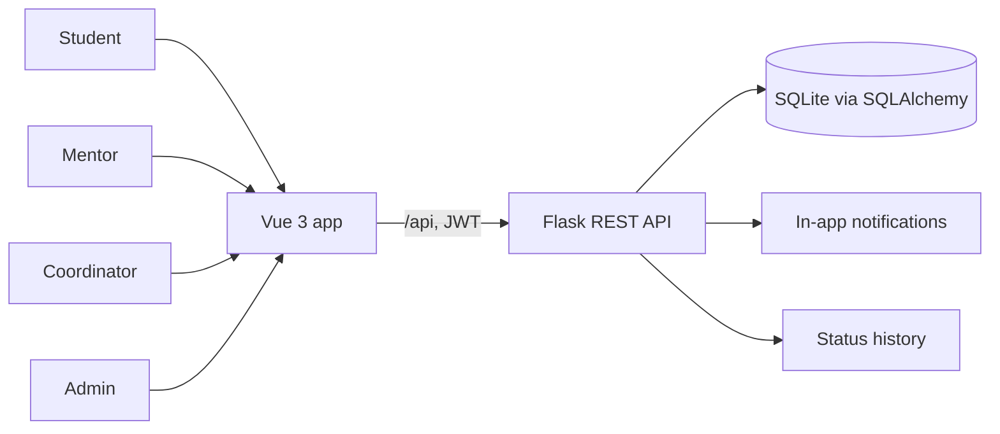
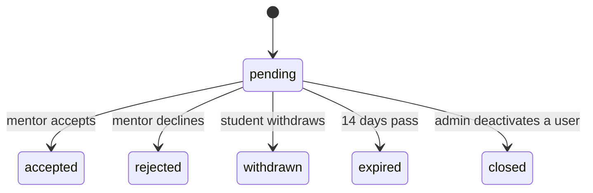
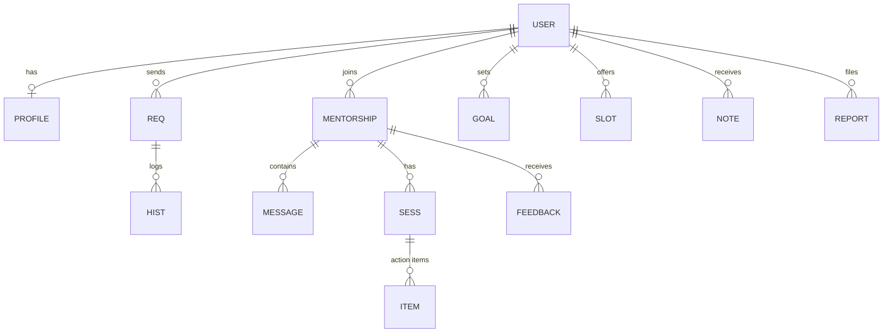

<div align="center">

# 🧭 MentorConnect

**Guidance that moves you forward.**
A mentoring platform that connects IITM BS students with alumni who have been where they are headed.


</div>

---

## 💡 Why it exists

Students nearing graduation face big career choices and often have no one to ask. Mentors are willing but get flooded. MentorConnect fixes both sides:

| Students said | Mentors said | So the platform |
|---|---|---|
| "I stare at LinkedIn profiles for an hour but never send a message." | "I got 15 emails in one week, so I stopped replying." | gives a searchable directory, a guided request, and **hard capacity limits** |
| "My request just disappeared." | "I felt guilty about ghosting." | shows request status and **expires unanswered requests after 14 days** |
| "We talked, then nothing happened." | "Students don't follow the advice." | tracks **goals, sessions and action items** |

## 🚀 Quick start

You need Python 3.10+ and Node.js 18+. Open two terminals.

**1. Backend**
```bash
cd backend
python3 -m venv venv && source venv/bin/activate    # Windows: venv\Scripts\activate
pip install -r requirements.txt
python app.py                                        # http://127.0.0.1:5000
```

**2. Frontend**
```bash
cd frontend
npm install
npm run dev                                          # http://localhost:5173
```

Demo data is created on first start. To reset it, stop the backend and run `rm -f instance/mentor.db mentor.db`.

## 🎬 Try it in 2 minutes

All demo passwords are `demo1234`.

| Step | Sign in as | Do this |
|---|---|---|
| 1 | `aarav@study.iitm.ac.in` (student) | Open **Mentors**, filter by Data Science, send a request to Priya (50+ characters) |
| 2 | `priya@mentorconnect.in` (mentor) | Open **Requests**, accept it, then open **Capacity** and see the limit enforced |
| 3 | `aarav@study.iitm.ac.in` | Open **Messages**, send a note, then log a **Session** with an action item |
| 4 | `kavya@mentorconnect.in` (coordinator) | Open **Insights** and read the supply and demand table |
| 5 | `admin@mentorconnect.in` (admin) | Open **Admin**, verify or deactivate a user, update a report |

Mentors who register themselves stay hidden from students until an admin verifies them. Students must register with an address ending in `study.iitm.ac.in`.

## ✨ What it does

<table>
<tr><td width="50%" valign="top">

### 🎓 For students
- Build a profile with level, interests, needs and up to 5 expertise areas
- Search mentors by career area, with an "open places" filter
- Send up to 3 pending requests at a time
- Withdraw a request any time, or let it expire after 14 days
- Track goals, book mentor slots, log sessions, message mentors
- Report a user, or delete the account

</td><td width="50%" valign="top">

### 🤝 For mentors
- Publish a profile with company, experience and support types
- Set capacity (1 to 10) and pause new requests
- Accept or decline with an optional reason
- Offer availability slots with no overlaps and no past times
- Read mentees' goals, log sessions, give private feedback

</td></tr>
<tr><td valign="top">

### 🧩 For coordinators
- See where student demand outruns mentor places
- Match unmatched students, who stay anonymous until matched
- Remind mentors about stuck requests

</td><td valign="top">

### 🛡️ For administrators
- Participation, acceptance rate and effectiveness insights
- Verify mentors, deactivate accounts
- Review reports and record the action taken

</td></tr>
</table>

### Rules the system enforces

- A full or paused mentor cannot receive requests. Lowering capacity never ends a current mentorship.
- Accepting a request unmasks both emails. A decided request cannot go back to pending.
- Anyone who is not part of a record gets a 404, so IDs cannot be probed.
- Mentors see goals but cannot edit them. Session dates cannot be in the future.
- Every status change is logged with who did it (`System` for expiry).
- Account deletion shows its effects first, then anonymises data after 30 days.

## 🏗 How it fits together



<details>
<summary><b>Request lifecycle</b></summary>


</details>

<details>
<summary><b>Database (13 tables)</b></summary>

`User`, `Profile`, `Req`, `Hist`, `Mentorship`, `Message`, `Note`, `Goal`, `Slot`, `Sess`, `Item`, `Feedback`, `Report`.


</details>

<details>
<summary><b>Tech stack and folders</b></summary>

| Area | Technology |
|---|---|
| Backend | Python, Flask, Flask-SQLAlchemy, PyJWT |
| Database | SQLite now, PostgreSQL-compatible |
| Auth | JWT, 120-minute expiry |
| Frontend | Vue 3, Vue Router, Vite |
| Tests | pytest |

```
backend/   app.py, test_app.py, test_more.py, requirements.txt
frontend/  index.html, vite.config.js, src/ (main.js, App.vue, api.js, views/)
docs/      diagrams, Gantt, Kanban, minutes, API YAML, reports
```
</details>

## 🧪 Tests

```bash
cd backend && source venv/bin/activate && pytest -q
```

17 tests cover sign-up rules, request limits, capacity, expiry, accept and message flow, profiles, goals, sessions, availability, feedback, reports, deletion, deactivation and coordinator matching.

## 📚 Project docs

<details>
<summary><b>User stories (16)</b></summary>

| ID | Story | Sprint |
|---|---|---|
| US-01 | Register and sign in with role-based access | 1 |
| US-02 | Create a student mentoring profile | 1 |
| US-03 | Create a mentor profile | 1 |
| US-04 | Manage mentoring capacity | 1 |
| US-05 | Search for mentors | 1 |
| US-06 | Submit a mentoring request | 1 |
| US-07 | Track request status | 1 |
| US-08 | Review and decide on requests | 1 |
| US-09 | Automated request expiry | 2 |
| US-10 | Define and track career goals | 2 |
| US-11 | Monitor platform participation | 2 |
| US-12 | Session feedback and action items | 2 |
| US-13 | Receive notifications | 2 |
| US-14 | Request account deletion | 2 |
| US-15 | Report inappropriate behaviour | 2 |
| US-16 | Manage mentor availability | 2 |
</details>

<details>
<summary><b>Schedule, milestones and tracking</b></summary>

| Milestone | Focus | Deadline |
|---|---|---|
| 1 | User requirements | Oct 25, 2026 |
| 2 | Scheduling and design | Nov 07, 2026 |
| 3 (Sprint 1) | APIs, tests, user testing (US-01 to US-08) | Nov 22, 2026 |
| 4 (Sprint 2) | APIs, tests, user testing (US-09 to US-16) | Dec 06, 2026 |
| 5 | Final report and prototype | Dec 20, 2026 |

Keep your exported diagrams in `docs/`: `gantt-chart.png`, `kanban-board.png`, `er-diagram.png`, `class-diagram.png`.

Scrum schedule and minutes go in `docs/scrum-minutes.md`. Issues, pull requests and code review screenshots go in `docs/`.
</details>

<details>
<summary><b>Where the build stands</b></summary>

All 16 stories have working backend endpoints and tests. Pages exist for sign-in, search, requests, capacity, messages, sessions, profile, goals, alerts, account, availability, insights and admin.

No page yet for mentor feedback, the mentees list, coordinator matching and the request timeline. Those work through the API only.
</details>

## 👥 Team

**Team 109 · IITM BS Software Engineering · September 2026 term · Option 2**

| Name | Roll number |
|---|---|
| Amit Kumar Gupta | 24F1002112 |
| Ovya Anand | 22f3001028 |
| Abhinava Maharudrappa Alur | 21F2000353 |
| Amol Wani | 21F1005443 |
| Taruna Choudhary | 22F3002199 |
| Amruthavarshini M | 21F3001976 |
